<p align="center">
  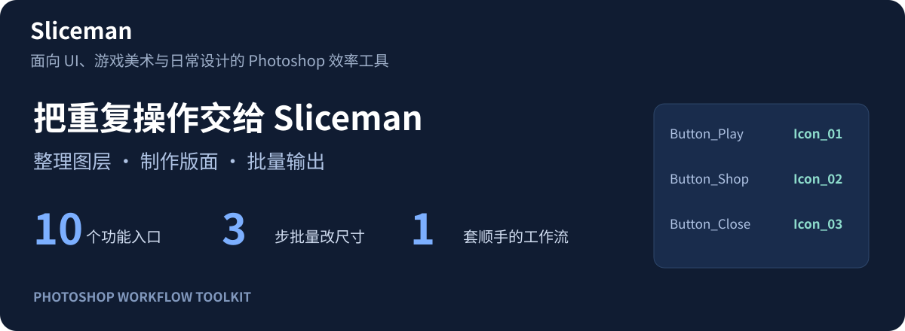
</p>

<p align="center">
  <strong>为 UI 设计、游戏美术和日常素材整理而做。</strong><br>
  少一些重复点击，多一些专注设计的时间。
</p>

<p align="center">
  <a href="https://github.com/dashuaigc/Sliceman/releases/latest"><strong>下载最新版</strong></a>　 ·　
  <a href="#start">下载安装</a>　 ·　
  <a href="#features">功能导航</a>　 ·　
  <a href="#recipes">跟着案例做</a>　 ·　
  <a href="#faq">常见问题</a>
</p>

<p align="center"><sub>适用版本 v1.4.5 · Photoshop 23.3 及以上 · Windows / macOS 快捷键按系统对应使用</sub></p>

---

## 让素材从「能用」变成「整齐、规范、好交付」

一份 PSD 里有几十个待改名的图层，一批图标需要对齐，一整套素材要改尺寸再导出——这些工作都可以放在 Sliceman 里完成。

| 整理图层 | 制作版面 | 批量交付 |
| :--- | :--- | :--- |
| 按名称找图层，统一改名与编号 | 精确平移、等距排版 | 整批修改图片尺寸 |
| 拆开素材，分别转智能对象或建组 | 绘制表格、创建定位格 | 按图层颜色或定位格导出图片 |
| **让源文件更清楚** | **让画面更规整** | **让输出更省事** |

> 界面图片来自 v1.4.5 的实际 HTML/CSS 浏览器渲染，使用示例数据，非 Photoshop 实机截图。绘制的示意图用于解释行为，未标尺寸的图形不代表精确比例。点击示意图可打开原图查看细节。

<a id="start"></a>

## 下载安装

1. 打开 [Release 下载页](https://github.com/dashuaigc/Sliceman/releases/latest)，下载文件名以 **`.ccx`** 结尾的安装包。
2. 双击安装包，按 Adobe 安装窗口的提示完成安装。
3. 重启 Photoshop，从 **「插件」菜单**打开 Sliceman。

双击没有反应时，先检查 Creative Cloud 桌面端是否已经安装并登录。通过 UXP Developer Tool 加载的开发版，使用方法见文末的开发说明。

<a id="features"></a>

## 功能导航 · 从你要做的事情开始

| 我想…… | 使用功能 | 操作结果 |
| :--- | :--- | :--- |
| 把一批图层改成统一名称 | [01 重命名](#rename) | 改图层名，支持连续编号 |
| 从一张素材里拆出多个元素 | [02 分割](#split) | 生成独立图层 |
| 每层分别转智能对象或套组 | [03 批处理](#batch) | 每个对象单独处理 |
| 精确移动或复制一排对象 | [04 平移](#move) | 整体按指定距离移动 |
| 把零散对象排整齐 | [05 排版](#layout) | 横排或竖排，统一间距 |
| 画一张表格或一组单元格 | [06 表格](#table) | 生成矢量形状图层 |
| 准备一批统一大小的图标位置 | [07 定位格](#grid) | 自动排列的矩形形状层 |
| 建参考线，并保存常用版面 | [08 参考线](#guides) | 创建、收藏、复用参考线 |
| 批量调整磁盘图片的宽高 | [09 改尺寸](#resize) | 按规则保存处理后的图片 |
| 把 PSD 图层导出成图片 | [10 切图](#slice) | 按层、组或定位格批量导出 |

---

<a id="rename"></a>

## 01 / 重命名

### 让几十个图层，使用同一套命名规则

**适合**：给按钮、图标、素材统一名称，批量替换词语，添加前后缀，自动编号。

重命名包含 **替换、重新命名、前缀、后缀** 四种方式，**数字编号 n** 可以与它们搭配使用。先在 Photoshop 图层面板选中需要处理的对象，再设置规则；结果预览会实时显示原名称与新名称，点击 **应用重命名** 后才正式改名。

### 替换 · 只改名字中的一部分

在“查找内容”中填写要修改的文字，在“替换为”中填写新文字。名称中匹配到的部分会改变，其余部分保留。

[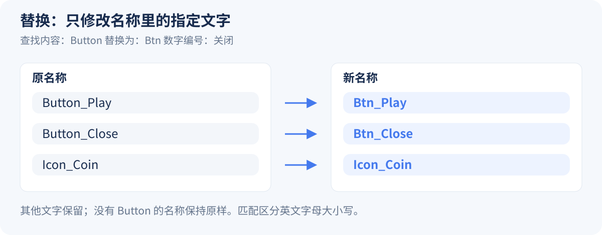](docs/readme-preview/14-rename-replace.svg)

**适合**：统一缩写、更换某个词、修正一批名称里的相同内容。例如把所有 `Button` 改成 `Btn`，同时保留各自的 `Play`、`Close` 等名称。

- 没找到指定文字的对象不改名，例如 `Icon_Coin` 中没有 `Button`，就保持原样。
- 同一个名称中出现多次查找内容，会全部替换。例如 `Button_Button` → `Btn_Btn`。
- 查找区分英文字母大小写，`Button` 与 `button` 不相同。

### 重新命名 · 换掉整个名字

将所选对象的完整名称改成输入的新文字，原名称不再保留。界面中的按钮名称是 **重新命名**。

[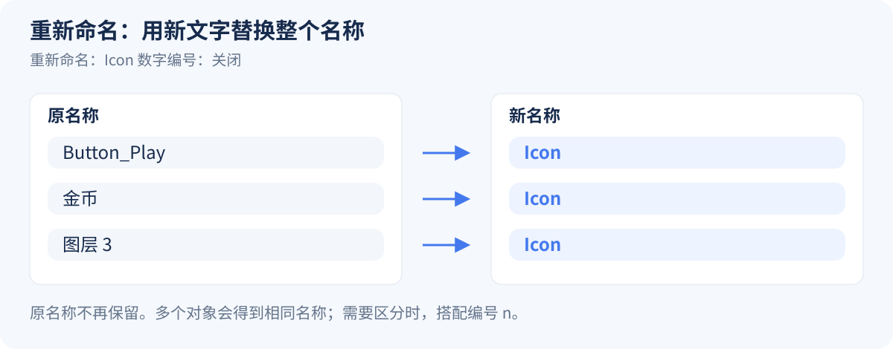](docs/readme-preview/15-rename-new.svg)

**适合**：原名称已经没有保留价值，想重新建立一套名称。只填 `Icon` 且关闭编号时，选中的对象都会叫 `Icon`；如果想让每个对象的名称不同，可填 `Icon_n` 并开启编号，具体见下方“编号 n”。

预览会提示本批次里的同名结果。先确认是否符合你的需要，再应用。

### 前缀 · 在名字前面加一段文字

保留原名称，把输入的内容添加到最前面：**新名称 = 前缀 + 原名称**。

[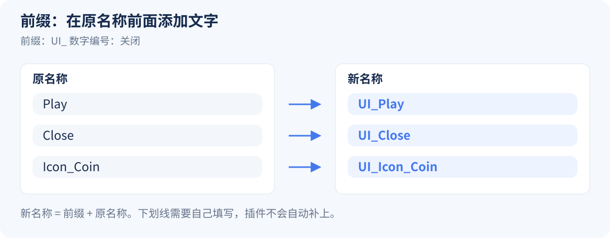](docs/readme-preview/16-rename-prefix.svg)

**适合**：为一批对象增加统一的项目名、页面名或分类，例如 `UI_`、`Shop_`、`Icon_`。

分隔符需要一起填写。填 `UI_` 得到 `UI_Play`；只填 `UI` 则得到 `UIPlay`。已经带有相同前缀的名称也会继续添加，例如 `UI_Play` 再加 `UI_` 会变成 `UI_UI_Play`。

### 后缀 · 在名字后面加一段文字

保留原名称，把输入的内容添加到最后面：**新名称 = 原名称 + 后缀**。

[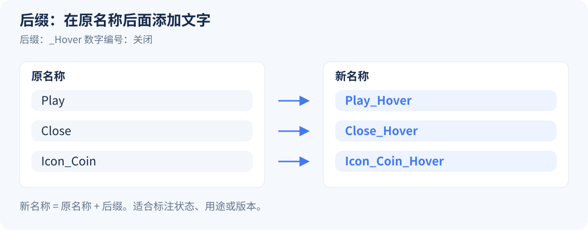](docs/readme-preview/17-rename-suffix.svg)

**适合**：标注按钮状态、资源用途或版本，例如 `_Hover`、`_Disabled`、`_v2`。

和前缀一样，下划线等分隔符需要自己填写；插件不会检查并去掉已有后缀。重复应用 `_Hover`，名称后面就会再次增加 `_Hover`。

### 编号 n · 让一批名字自动排上序号

`n` 是“这里放数字”的占位符。**开启“数字编号 n”，并在输入模板中写入独立的小写 `n`**，它才会变成实际编号。

[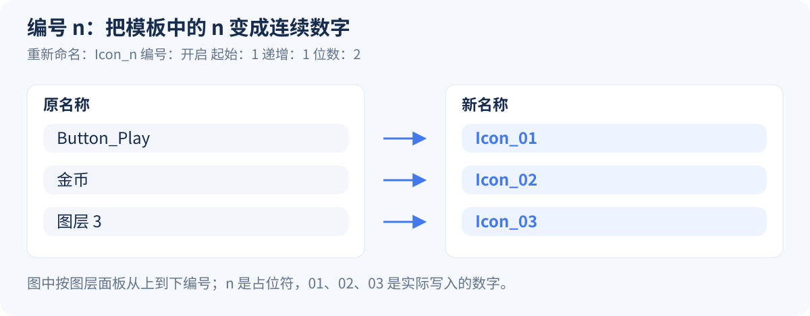](docs/readme-preview/18-rename-counter.svg)

| 设置 | 含义 | 结果举例 |
| :--- | :--- | :--- |
| 起始数字 | 第一个对象从几开始 | 起始 `5` → `05`、`06`、`07` |
| 递增数字 | 下一个编号增加多少 | 起始 `1`、递增 `2` → `01`、`03`、`05` |
| 数字位数 | 位数不足时在前面补 0 | 数字 `1` 选 1 / 2 / 3 / 4 位 → `1` / `01` / `001` / `0001` |
| 命名方向 | 按图层面板从上往下，或从下往上分配编号 | 选“从下到上”时，最下面的选中对象先拿到起始数字 |

位数是最少显示位数，不会截掉大数字。例如选择 2 位，数到 `100` 时仍显示 `100`。

**编号可以放在哪里？** 以下例子均开启编号，起始为 1、递增为 1、位数为 2，原名称按表内顺序处理。

| 搭配方式 | 输入内容 | 原名称 → 新名称 |
| :--- | :--- | :--- |
| 重新命名 + 编号 | `Icon_n` | `Play` → `Icon_01`；`Close` → `Icon_02` |
| 前缀 + 编号 | `n_` | `Play` → `01_Play`；`Close` → `02_Close` |
| 后缀 + 编号 | `_n` | `Play` → `Play_01`；`Close` → `Close_02` |
| 替换 + 编号 | 查找 `Button`，替换为 `Icon_n` | `Button_Play` → `Icon_01_Play`；`Button_Close` → `Icon_02_Close` |

**哪些 n 会变成数字？**

- `Icon_n`、`n_Play`、`UI_n_Hover` 中的 n 是独立标记，可以编号。
- `Button`、`Icon`、`Iconn` 中的 n 与英文字母连在一起，不会被替换；推荐用下划线把编号隔开。
- 关闭编号开关时，`Icon_n` 会原样保留为文字，不会自动变成 `Icon_01`。
- 替换模式下，未匹配的对象不会占用编号；同一个名称里有多个编号标记时，会使用该对象的同一个编号。

> **作用范围**：只修改图层面板中真正选中的图层或组。只选中组时，只改组名；要修改组内图层的名称，需要把它们也选中。尚未输入修改内容时，预览中的新名称与原名称相同。

<p align="center">
  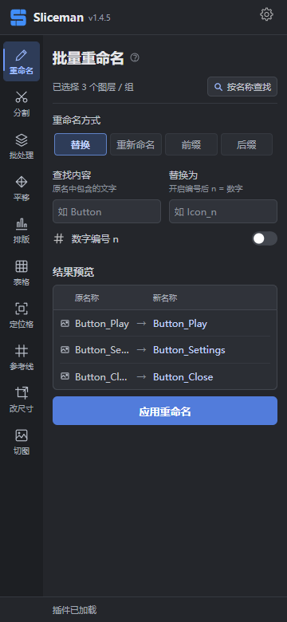　
  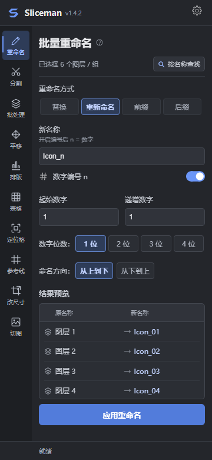
</p>

### 图层太多？先「按名称查找」

1. 点击 **按名称查找**，输入关键词，例如 `Button`。
2. 选择匹配方式、查找范围和图层类型，点击 **搜索**；输入过程中也会更新结果。
3. 取消不需要的结果，点击 **添加到查找列表**。
4. 需要再查另一批时，点击 **继续添加**；全部准备好后点击 **确认**。
5. 查到的图层会在 Photoshop 图层面板中选中，接着使用重命名即可。

| 想查的内容 | 匹配方式 |
| :--- | :--- |
| 名字里任何位置有 `Button` | 包含 |
| 名字就是 `Button` | 完全匹配 |
| 名字以 `Button` 开头 | 前缀 |
| 名字以 `_Hover` 结尾 | 后缀 |

默认也会查找隐藏图层。多组关键词匹配到同一图层时，最终结果会去重；“添加到查找列表”是在整理候选项，最后点“确认”才应用选中结果。

<details>
<summary><strong>查看查找窗口与查找列表</strong></summary>

<p align="center">
  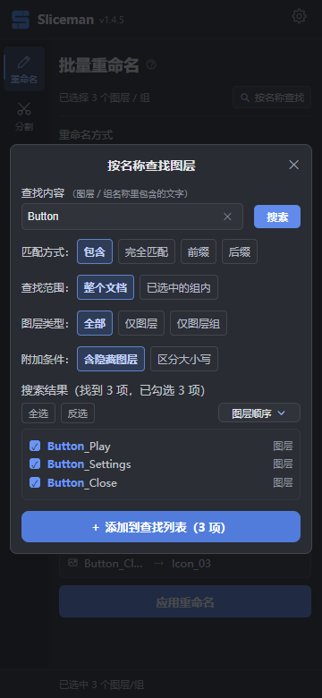　
  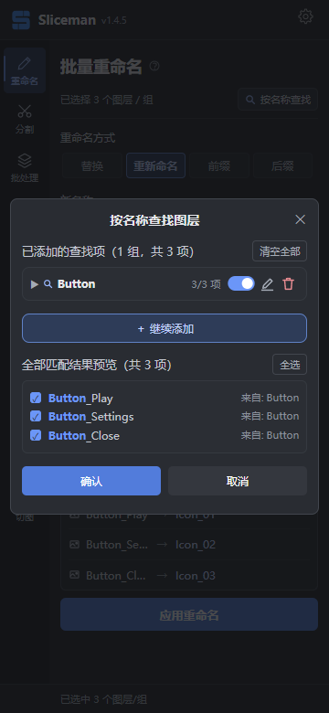
</p>

可以在查找列表中编辑、停用或删除某个关键词。关闭或取消窗口不会应用本次选中结果。

</details>

---

<a id="split"></a>

## 02 / 分割

### 把一张素材，拆成可单独操作的图层

**适合**：一张透明底素材里放着多个图标，或需要沿固定网格把画面切成小块。

[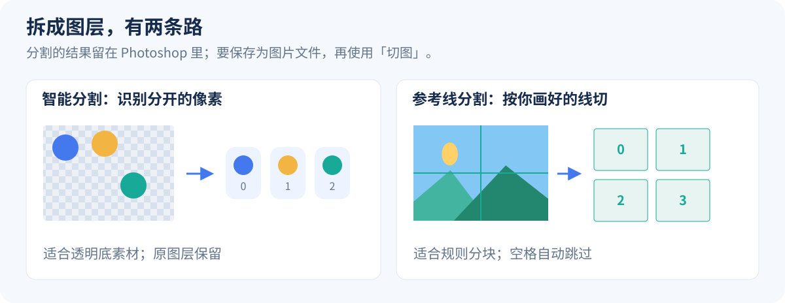](docs/readme-preview/02-split.svg)

| 你手上的素材 | 选哪种分割 |
| :--- | :--- |
| 元素之间有透明间隔，希望自动识别 | **智能分割** |
| 内容连在一起，或必须按指定位置切 | **参考线分割** |

**智能分割怎么用**

1. 选中一个包含多个分离元素的 **像素图层**。
2. 进入 **分割**，点击 **开始智能分割**。
3. 新图层会按从上到下、每行从左到右的顺序，以 `0`、`1`、`2`… 编号。

<a id="split-keep-elements"></a>

### 保持元素完整 · 让断开的部件尽量留在一起

有些图案看起来是一个元素，像素却并不相连。例如小写字母 **i**，上面的圆点与下面的主体之间有透明间隔。如果只按像素是否相连来拆，它们就会成为两个图层。

[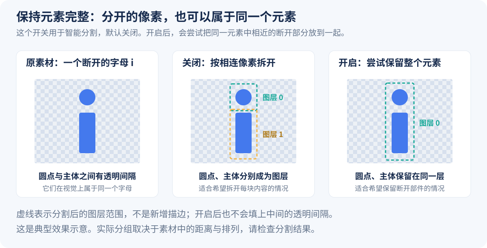](docs/readme-preview/19-split-keep-elements.svg)

| 开关状态 | 怎样分割 | 字母 i 的典型结果 |
| :--- | :--- | :--- |
| **关闭（默认）** | 按像素是否相连区分内容块，互相断开的部分分别拆出 | 圆点一层，主体一层 |
| **开启** | 尝试把距离较近、可能属于同一元素的断开部分合在一起处理 | 圆点与主体保留在同一层 |

**这里的“完整”，指的是分组完整，不是修补图片。** 开启后不会把圆点移到主体上，也不会填满中间的透明间隔；只是尽量把这些部件放在同一个输出图层里，保留原来的位置关系。

**哪些情况适合开启？**

- 一个图标由几块互不相连的图案组成，希望拆出后仍作为一个整体使用。
- 字母、符号的圆点或小部件与主体分离，不希望拆散。
- 素材边缘存在细小断裂，关闭时被拆成过多碎块。

**哪些情况更适合关闭？** 如果每个分开的内容块都需要独立处理，或者相邻的不同图标被合在了一起，可以关闭后重新分割。开启时依据素材的间距与排列判断，不能保证所有复杂素材都分得完全符合预期。

想严格控制分割边界时，使用下面的 **参考线分割**。整片不透明背景把内容连在一起时，也不能靠“保持元素完整”来区分图标，应先处理背景或改用参考线。

**参考线分割怎么用**

1. 在 Photoshop 中拖出参考线，或用「参考线」功能建立版面。
2. 选中要分割的一个图层或组。
3. 查看面板显示的行列数，点击 **按参考线分割**。

想切整张可见画面时，开启 **合并可见内容**。画布边缘也是分割边界；空白格子会跳过。结果直接生成独立像素图层，保留原对象，不自动新建组。

<p align="center">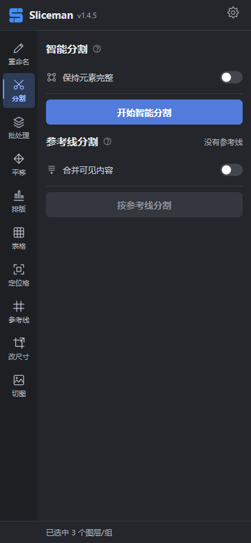</p>

> **分割 ≠ 切图**：分割是在 PSD 中“拆出图层”；切图是把内容“保存成图片文件”。可以先分割，再切图。

---

<a id="batch"></a>

## 03 / 批处理

### 选中一批对象，每个对象分别处理

[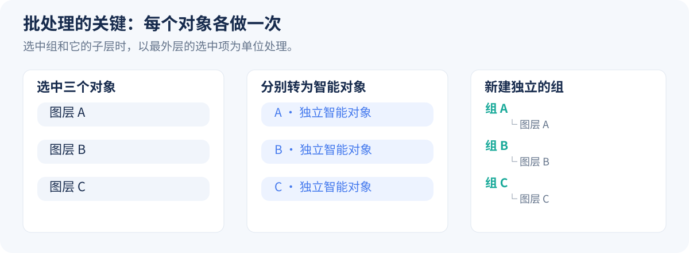](docs/readme-preview/03-batch.svg)

**分别转成智能对象**

1. 在图层面板里选中多个图层或组。
2. 进入 **批处理**，点击 **批量转为智能对象**。
3. 每个对象会成为独立智能对象，原来已经是智能对象的会跳过。

**分别新建独立的组**

1. 选中需要整理的多个对象。
2. 点击 **批量新建独立组**。
3. 每个对象外面新增一个父组，组名沿用该对象名称。

例如 `Icon_Coin`、`Icon_Gem` 两个图层，会变成两个独立的同名组，各自包含原图层。选中组和组内子层时，按最外层选中对象处理，避免重复套层。

<p align="center">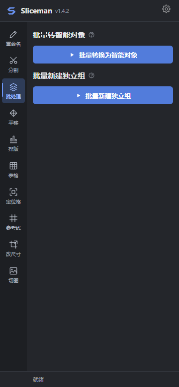</p>

---

<a id="move"></a>

## 04 / 平移

### 向指定方向，精确移动一段距离

[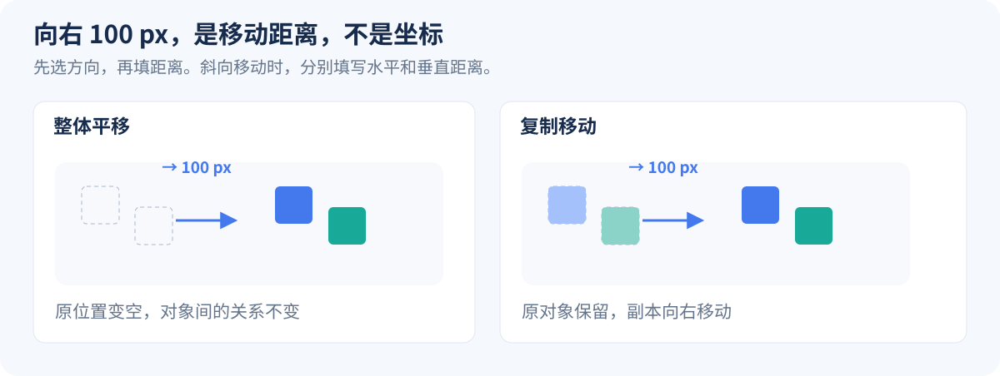](docs/readme-preview/04-move.svg)

左右移动只需水平距离，上下移动只需垂直距离；选择斜向时，两项都要填写。多个对象一起移动时，它们之间的相对位置保持不变。

**做一排等距副本**：打开 **复制移动**，选择向右，填好距离后执行。每次会保留原对象并移动新副本；副本仍处于选中状态，继续点击即可接着复制。

距离是“本次移动多少”，不是对象最后的坐标。连续点击会累加；负数会反转对应方向。锁定层、背景层会跳过，画布不会自动扩展。

<p align="center">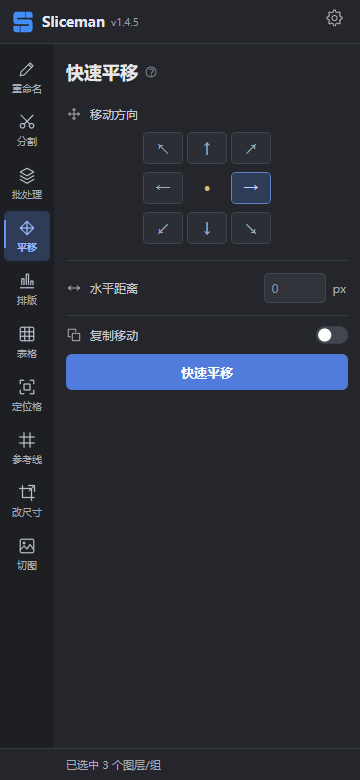</p>

---

<a id="layout"></a>

## 05 / 排版

### 按画面顺序，把零散对象排整齐

### 横排与竖排 · 决定对象朝哪个方向排列

选中至少两个对象，设置排列方向、对齐方式和间距，再点击 **一键排版**。横排把对象排成一行，竖排把对象排成一列。

[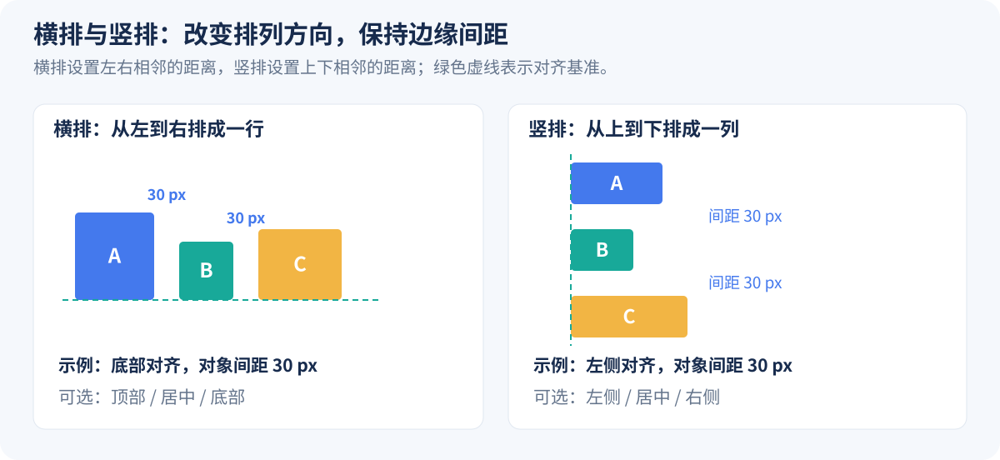](docs/readme-preview/20-layout-directions.svg)

| 排列方向 | 对象怎样排列 | 可以怎样对齐 | 间距量哪里 |
| :--- | :--- | :--- | :--- |
| **横排** | 从左到右排成一行 | 顶部 / 居中 / 底部 | 前一个对象右边缘到后一个对象左边缘 |
| **竖排** | 从上到下排成一列 | 左侧 / 居中 / 右侧 | 前一个对象下边缘到后一个对象上边缘 |

**对象间距不是中心点之间的距离。** 不同大小的对象也会按边缘留出相同间隔。例如设置 30 px，无论前一个对象多宽、多高，两者之间都留出约 30 px 的空隙；像素取整可能产生最多 1 px 的差异。

排序根据对象在画面中的位置，**不按图层列表顺序**：横排先识别行，再从左到右；竖排先识别列，再从上到下。排序后的第一个对象保持原位，其余依次排列。对象有锁定时，需要先解锁再排版。

### 自动扩展画布 · 排完放不下时，扩大画布

[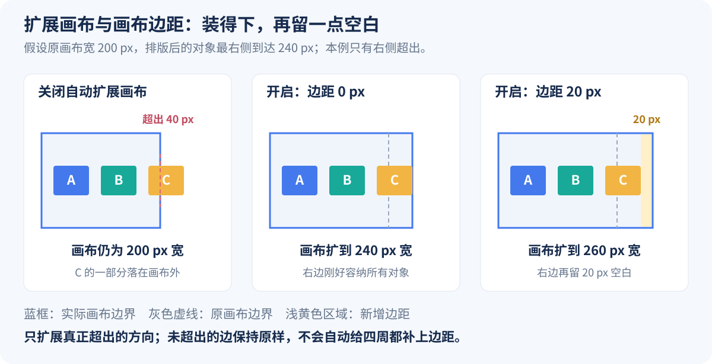](docs/readme-preview/21-layout-canvas.svg)

假设原画布宽 **200 px**，排版后最后一个对象的右边缘到达 **240 px**，超出了 40 px：

| 设置 | 结果 |
| :--- | :--- |
| 自动扩展画布 **关闭** | 画布仍为 200 px 宽，超出的对象内容落在画布外 |
| 自动扩展画布 **开启**，画布边距 **0 px** | 右侧扩展 40 px，画布变为 240 px 宽，刚好容纳对象 |
| 自动扩展画布 **开启**，画布边距 **20 px** | 右侧扩展 60 px，画布变为 260 px 宽，对象右边再留 20 px 空白 |

扩展画布不会缩放对象，也不会为了适应画布而改变你设置的对象间距。关闭时只是保持原画布尺寸，不会自动把超出的对象挪回来。

### 画布边距 · 对象与新画布边缘之间的留白

**对象间距**管“对象与对象之间”；**画布边距**管“超出后，对象与新画布边缘之间”。两者是独立设置，例如对象间距 30 px、画布边距 20 px 可以同时使用。

画布边距只在开启自动扩展、且对象确实超出某一边时生效。**只扩展超出的方向，不会统一补齐四边。** 上图只向右扩展，上、下、左边保持不变；如果对象完全位于画布内，即使边距填了 20，也不会为了补边而扩大画布。

<p align="center">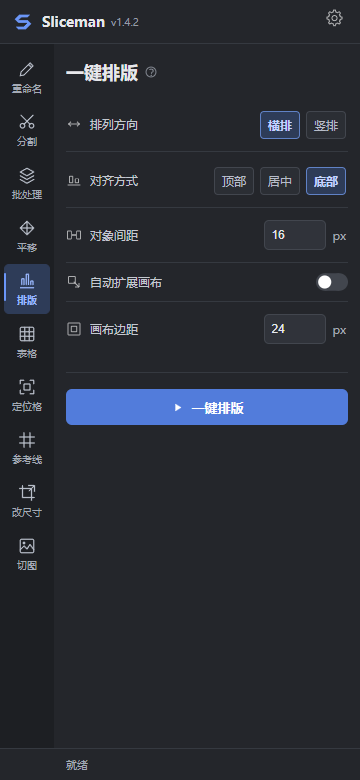</p>

---

<a id="table"></a>

## 06 / 表格

### 输入行列与尺寸，直接画出矢量表格

表格由三组选择决定：**尺寸方式**决定宽高代表一格还是整张，**输出**决定生成多少个图层，**结构**决定画哪些线。设置完成后点击 **绘制表格**，结果会出现在当前视图附近的中央位置。

### 尺寸方式 · 宽和高是在描述一格，还是整张表？

[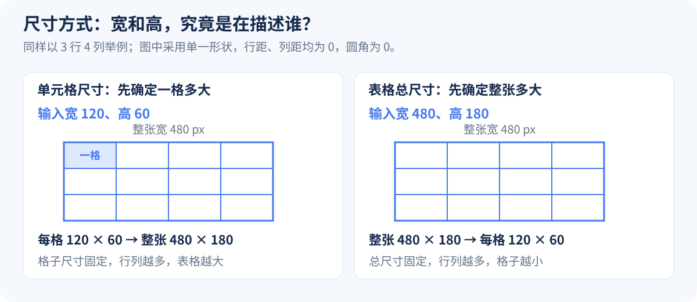](docs/readme-preview/22-table-size.svg)

**单元格尺寸**

宽、高表示 **一个格子的尺寸**。适合已经确定每格要放多大的图标、卡片或内容，再决定需要几行几列的情况。

例如宽 `120`、高 `60`，设置 3 行 4 列，在单一形状、行列间距为 0 时，整张表为 `480 × 180`。保持每格尺寸不变，增加行列数量，整张表就会变大。

**表格总尺寸**

宽、高表示 **整张表的外部尺寸**。适合需要把表格放进一个固定区域，例如宽 480、高 180 的界面模块。

同样设置 3 行 4 列、间距为 0，插件会把这块区域分配成每格 `120 × 60`。保持总尺寸不变，增加行列数量，每格就会变小；如果增加行距、列距，也会从总尺寸中扣除这些空隙，再计算格子大小。

| 对比 | 单元格尺寸 | 表格总尺寸 |
| :--- | :--- | :--- |
| 宽、高表示 | 一格的宽、高 | 整张表的宽、高 |
| 增加行列数量 | 每格大小不变，整张表变大 | 总宽高不变，每格变小 |
| 增加行距、列距 | 总尺寸随空隙增加 | 格子尺寸缩小，为空隙留位置 |
| 常见用途 | 固定大小的卡片、格子 | 填满某个固定尺寸的区域 |

切换尺寸方式时，宽高输入框会自动换算。**如果必须精确控制成品总宽高，直接选择“表格总尺寸”。** 独立单元格在无间距时会让相邻描边重叠，避免共用边变粗，因此它的总尺寸不宜直接用“单格尺寸 × 数量”心算。

### 输出 · 整体一层，还是每格一层？

[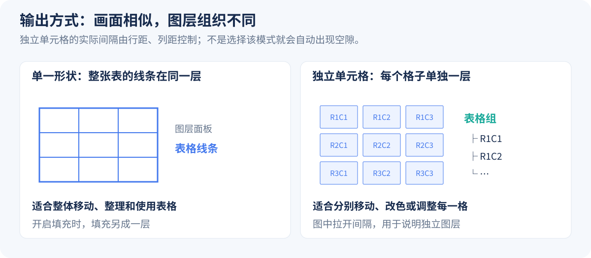](docs/readme-preview/23-table-output.svg)

**单一形状**

整张表的线条合在 **一个形状图层** 中，适合把表格当作整体移动、缩放和管理。名称里的“单一”指图层组织，并不表示只画一个格子。

开启“单元格填充”时，填充另建一个图层，与线条一起放进组中，方便分别控制线条和底色。想选择外边框、内横线、内竖线的组合，就使用这个输出方式。

**独立单元格**

**每个格子生成一个独立矩形形状图层**，集中放在一个组里。名称如 `R1C1` 表示第 1 行第 1 列，`R2C3` 表示第 2 行第 3 列。

适合后续逐格移动、修改颜色、调整大小，或把某些格子单独拿出来使用。每格有自己的描边和填充；无间距时相邻描边会重叠，避免内部线比外框更粗。

| 对比 | 单一形状 | 独立单元格 |
| :--- | :--- | :--- |
| 图层组织 | 表格线条集中在一层；开启填充时另加填充层 | 每格一层，统一放入组内 |
| 后续编辑重点 | 整张表格 | 每一个格子 |
| 外边框 / 内横线 / 内竖线 | 可组合选择 | 自动置灰，不参与生成 |
| 描边与填充 | 分开成层 | 每格可同时具有描边和填充 |

### 结构 · 分别控制外圈、横线与竖线

三个选项是 **独立开关，可以多选**，不是三选一。以下图示使用“单一形状”，5 行 6 列，行距、列距和圆角均为 0，并关闭单元格填充。每组只切换一个选项，另外两项一直开启；左边看开启效果，右边看关闭后少了哪些线。

[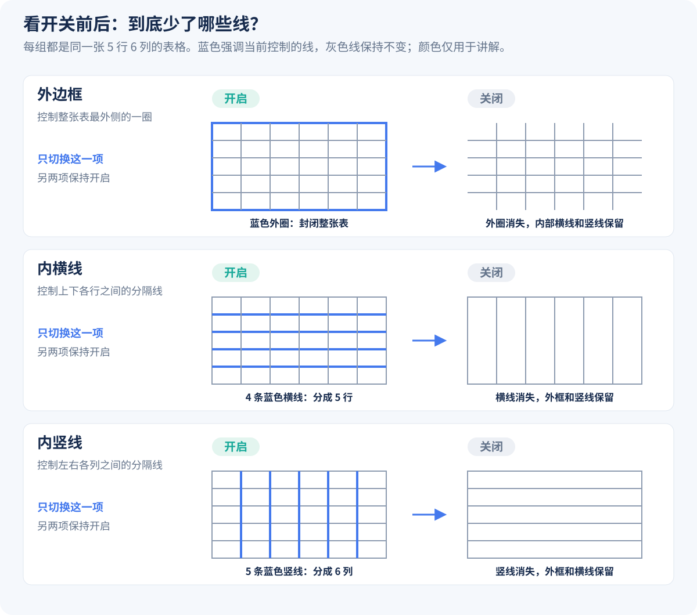](docs/readme-preview/24-table-structure.svg)

**外边框 · 表格最外面的一圈**

开启后，画出整张表的上、下、左、右外边缘。只开启外边框时，会得到一个外框，内部没有行列分隔线；关闭它时，内部线仍可保留，但没有外围封闭边框。设置圆角时，连续表格的圆角作用于外轮廓，内部线仍保持直线。

**内横线 · 分开上下各行**

开启后，在行与行之间绘制水平线。图中的 5 行对应 **4 条内横线**；1 行没有需要分隔的位置，因此不会生成内横线。它不负责最上面、最下面的边框，这两条由“外边框”控制。

适合列表、横向条目、记录表等需要逐行区分的布局。

**内竖线 · 分开左右各列**

开启后，在列与列之间绘制垂直线。图中的 6 列对应 **5 条内竖线**；1 列不会生成内竖线。它不负责最左边、最右边的边框，这两条也由“外边框”控制。

适合分栏信息、横向对比等需要区分列的布局。

### 结构可以怎样搭配？

[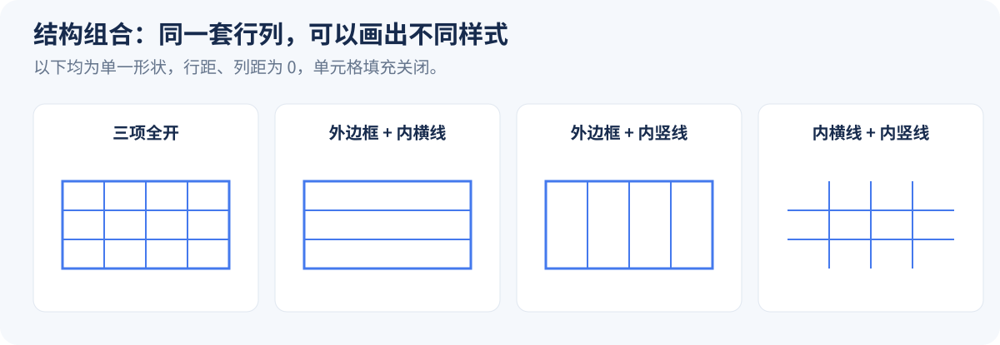](docs/readme-preview/25-table-combinations.svg)

| 选择的结构 | 得到的效果 |
| :--- | :--- |
| 外边框 + 内横线 + 内竖线 | 有完整外框、行列分隔线的表格 |
| 外边框 + 内横线 | 外框中按行分隔，内部不分列 |
| 外边框 + 内竖线 | 外框中按列分隔，内部不分行 |
| 内横线 + 内竖线 | 保留内部网格，去掉最外围边框 |

**行距或列距大于 0 时要注意**：格子之间已经分开，单一形状会改用逐格描边的方式绘制，而不是上图这种连续网格；此时不能按连续表格来理解三项结构的效果。想精确得到上面的外框、横线、竖线组合，请将行距、列距设为 0。

### 其他设置怎样影响外观？

- **行距 / 列距**：格子之间的空隙；0 表示相邻排列。
- **粗细 / 颜色**：控制线条的宽度与颜色。
- **圆角**：控制相应外轮廓的圆角大小，创建前设置。
- **单元格填充**：给格子加底色；它与线条是否存在是不同的设置。

<p align="center">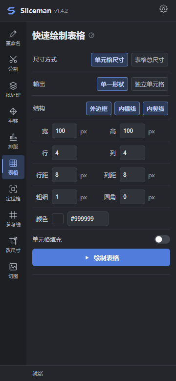</p>

> 结果是矢量形状。独立单元格的圆角不能直接在 Photoshop 属性面板中重新设置，建议在创建前填好圆角；需要调整时撤销并重新绘制。

---

<a id="grid"></a>

## 07 / 定位格

### 给一批图标，准备统一的尺寸基准

[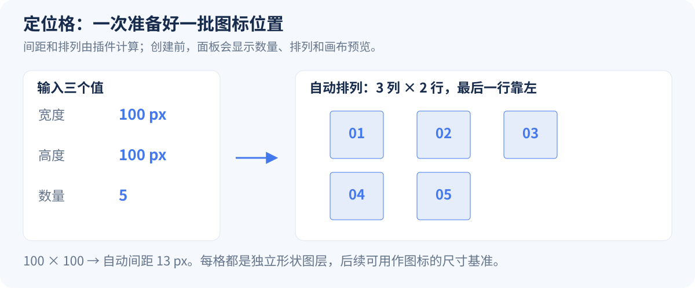](docs/readme-preview/07-grid.svg)

填写宽度、高度和数量，面板会自动计算间距与排列，并显示预览。点击 **创建定位格** 后，生成 `定位格 01`、`定位格 02` 等独立矩形形状图层，不自动建组。下面三个开关决定创建位置、画布处理和辅助参考线。

### 在新 PSD 中创建 · 单独建一个文档，还是放进当前文档？

[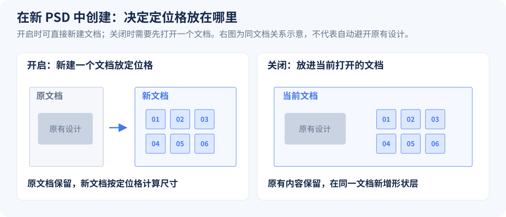](docs/readme-preview/26-grid-document.svg)

**开启（默认）**：新建一个 Photoshop 文档来放置这批定位格，不往原文档添加内容。新文档尺寸由整批定位格的外框和四周留白自动计算，不需要事先创建空白文档，适合从头准备一套图标素材。

新文档里会有一层透明的“背景”和各个定位格。这里的“新 PSD”指新建文档，**不是自动在磁盘上保存一个 PSD 文件**；需要保存时，仍要在 Photoshop 中保存。

**关闭**：把定位格画进当前激活的文档，保留原有内容，适合在现有稿件中增加图标基准框。需要先打开文档；整批定位格按画布居中放置，不会自动识别并避开已有设计，可能与原内容重叠。

### 自动扩展画布 · 当前画布不够大时怎么办？

[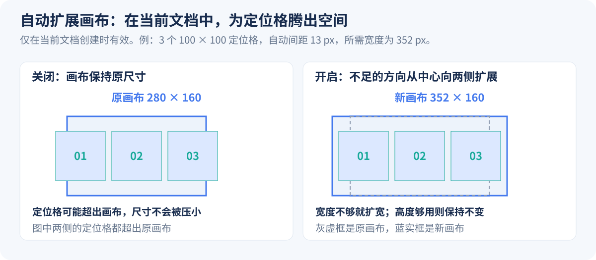](docs/readme-preview/27-grid-expand.svg)

这个开关 **只在关闭“在新 PSD 中创建”时有效**。新建文档本来就会按定位格计算合适尺寸，因此开启新建文档时，自动扩展画布这一行会置灰。

**开启**：当前画布放不下整批定位格时，从中心向两侧扩展不足的方向，并为定位格留出安全边距。只扩不够的宽度或高度，不会缩小原画布，也不会裁掉原有内容或缩小定位格。

**关闭**：保持原画布尺寸，定位格仍按设定大小创建；放不下的部分可能落在画布外。创建前后的面板提示会说明是否超出。

**留白不用另外填写**：定位格功能自动计算间距，扩展时的安全边距采用这个间距值。它与“排版”页可手动填写的画布边距不是同一个设置。

| 当前情况 | 开启自动扩展后的处理 |
| :--- | :--- |
| 宽度不足，高度够用 | 从中心向左、右扩宽，高度不变 |
| 高度不足，宽度够用 | 从中心向上、下扩高，宽度不变 |
| 宽度、高度都不足 | 两个方向都扩展 |
| 当前画布足够容纳定位格 | 保持原画布大小 |

### 自动创建参考线 · 为每格标出四边和中心

[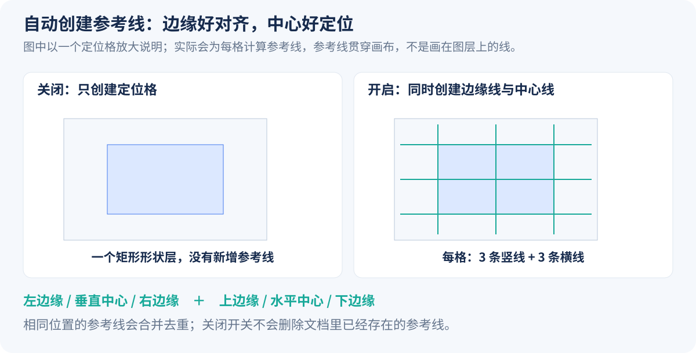](docs/readme-preview/28-grid-guides.svg)

**开启（默认）**：创建定位格时，同时计算每格对应的 **6 个参考线位置**：

- **3 条竖线**：左边缘、垂直中心、右边缘，用来找左右边界与横向中心。
- **3 条横线**：上边缘、水平中心、下边缘，用来找上下边界与纵向中心。

把图标放进定位格时，中心十字方便对中，四边方便检查尺寸和边界。参考线属于 Photoshop 的画布辅助线，不是新建的图层，也不会成为图标内容。

**关闭**：只创建定位格，不新增这些参考线。已有参考线不会因此被删除；想隐藏或清除它们，可到“参考线”页操作。

多个定位格会共用一些参考线位置，与文档中已有参考线重合的位置也会跳过，因此最终新增数量 **不一定等于“格子数 × 6”**。例如同一排的格子高度一致，它们的上边缘、中线、下边缘通常只需要共用三条横线。

### 三个开关怎样搭配？

| 你的用途 | 设置组合 |
| :--- | :--- |
| 新做一套图标，需要对齐辅助 | 在新 PSD 中创建：开；自动创建参考线：开；扩展画布无需设置 |
| 在现有稿件中添加定位格，允许画布变大 | 在新 PSD 中创建：关；自动扩展画布：开；参考线按需选择 |
| 现有稿件必须保持原画布大小 | 在新 PSD 中创建：关；自动扩展画布：关；创建前检查是否会超出 |

不足一整行时靠左排列；数量超过 9 时，会结合格子的实际宽高选择较方正的排列。每次点击都会新建一批，不会替换上一次的结果。

<p align="center">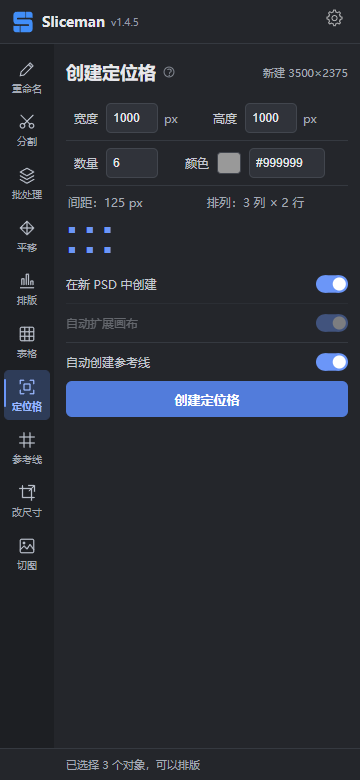</p>

**和表格的区别**：表格更适合控制行列、线条和间距；定位格只需宽、高、数量，自动安排版式，更适合一批图标的准备工作。要用于 Symbols 切图，后续需把**每个图标与它的定位格放入各自的组**。

---

<a id="guides"></a>

## 08 / 参考线

### 常用的版面，建一次就能反复用

[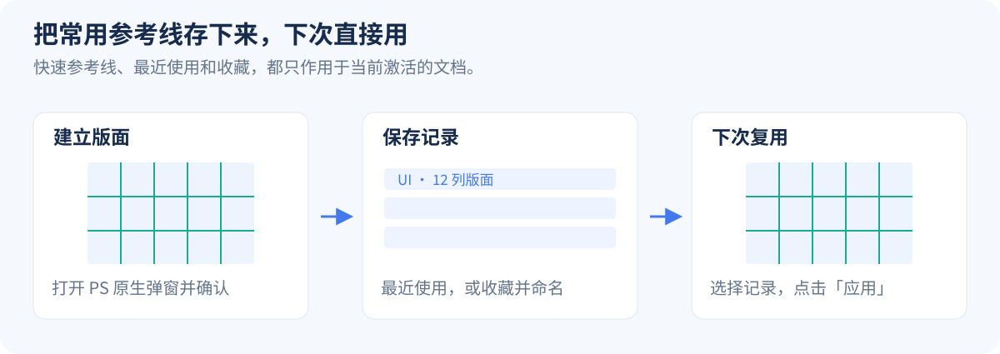](docs/readme-preview/08-guides.svg)

**建立并收藏一套参考线**

1. 打开文档，进入 **参考线**，点击 **新建参考线版面**。
2. 在 Photoshop 原生弹窗中填写行数、列数、间距和边距；可打开预览查看效果。
3. 点击确定创建后，打开 **最近使用**，找到刚才的版面并收藏。
4. 下次打开 **收藏版面**，点击对应记录的 **应用** 即可。

最近使用保留 20 条；常用记录可以收藏并改名，例如“商店页 4 列”。删除一条记录不会删除文档中的参考线。

| 快捷操作 | 效果 |
| :--- | :--- |
| 十字中心 | 添加一条水平中线和一条垂直中线 |
| 九宫格 | 横、竖各三等分，添加四条线 |
| 收藏当前版面 | 保存当前文档里已有的一套参考线 |
| 隐藏 / 显示 | 只改变可见性，线仍然存在 |
| 锁定 / 解锁 | 控制是否能拖动参考线 |
| 清除参考线 | 可清除全部、仅横向或仅纵向 |

<p align="center">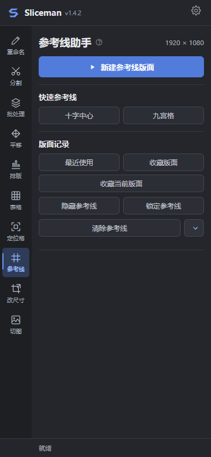</p>

<details>
<summary><strong>换一张不同尺寸的画布，收藏还能用吗？</strong></summary>

可以，但取决于记录方式。规则版面里的自动宽高会按当前画布重新计算，固定像素尺寸则保留原值。手动摆放、无法识别为规则版面的参考线，会按原坐标保存为快照，重放时不会按画布比例缩放。列表和状态栏会说明记录类型。

如果在 Photoshop 中移动过标尺原点，参考线位置也会受影响。

</details>

---

<a id="resize"></a>

## 09 / 改尺寸

### 选择图片 → 尺寸设置 → 输出与处理

**适合**：统一一批图片的宽度、把海报变成指定尺寸、限制大图尺寸、批量放大或缩小。每张源图片按当前规则输出一张结果图。

<p align="center">
  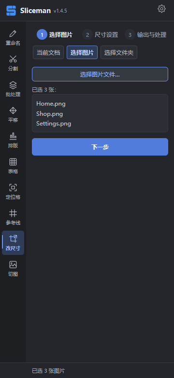　
  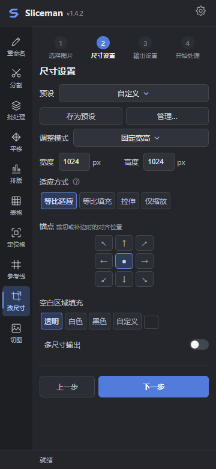　
  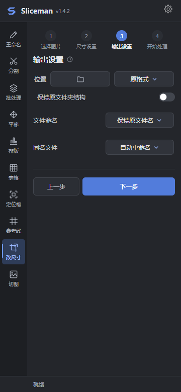
</p>

### 第一步：图片从哪里来

| 来源 | 怎么用 |
| :--- | :--- |
| 选择图片 | 一次选择多个图片文件，适合少量或分散的文件 |
| 选择文件夹 | 扫描整个文件夹；开启“包含子文件夹”可一起读取下级目录 |
| 当前文档 | 处理 Photoshop 中当前打开的文档副本，保留原文档 |

支持选择 JPG、PNG、WebP、PSD、TIFF、BMP 等图片文件；不支持的文件会被忽略。选择后先看文件清单，确认没有多选或漏选，再进入下一步。

### 第二步：先想清楚，你要统一什么

下面八张图都使用同一张 **1600 × 800** 的横图，直接比较原图与处理结果。示意图按比例显示缩放；“最长边 / 最短边”也列出了竖图的对应结果。

#### 01 · 指定宽高

控制目标画布的宽和高，图片怎么放进去由适应方式决定。下图以“等比适应”为例。

[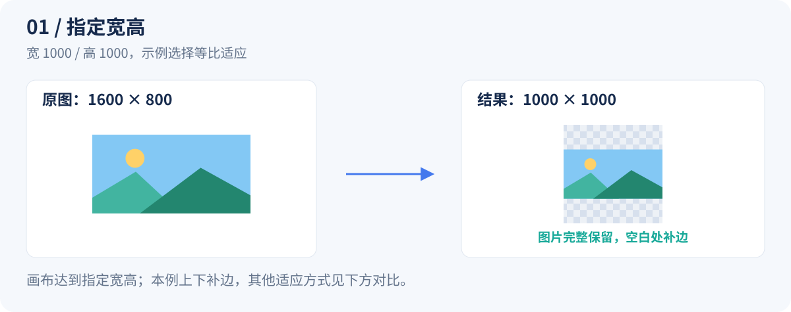](docs/readme-preview/29-resize-wh.svg)

#### 02 · 按宽度缩放

只填宽度，高度自动按原比例计算。

[](docs/readme-preview/30-resize-w.svg)

#### 03 · 按高度缩放

只填高度，宽度自动按原比例计算。

[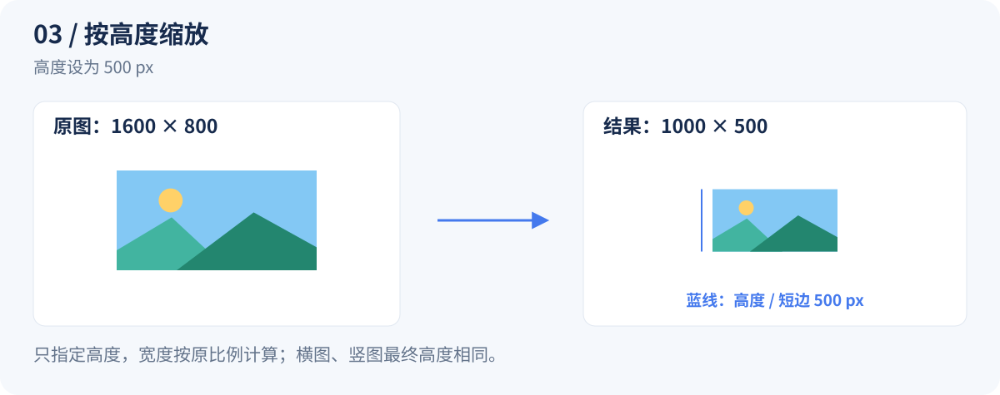](docs/readme-preview/31-resize-h.svg)

#### 04 · 最长边

自动判断哪一边更长：横图控制宽，竖图控制高。

[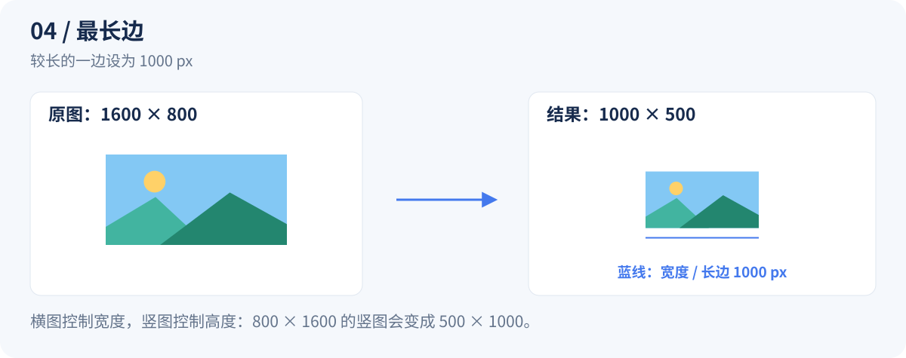](docs/readme-preview/32-resize-long.svg)

#### 05 · 最短边

自动判断哪一边更短：横图控制高，竖图控制宽。

[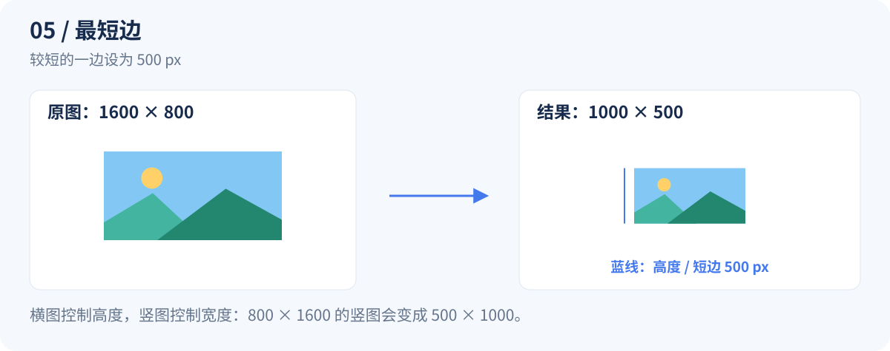](docs/readme-preview/33-resize-short.svg)

#### 06 · 百分比缩放

宽和高分别乘以百分比。50% 表示宽高都减半，不是总像素数量减半。

[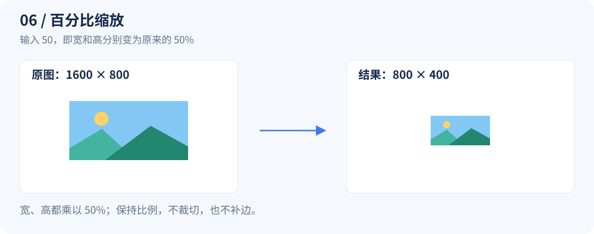](docs/readme-preview/34-resize-percent.svg)

#### 07 · 尺寸倍数

宽和高分别乘以倍数；2 倍表示宽高都翻倍。

[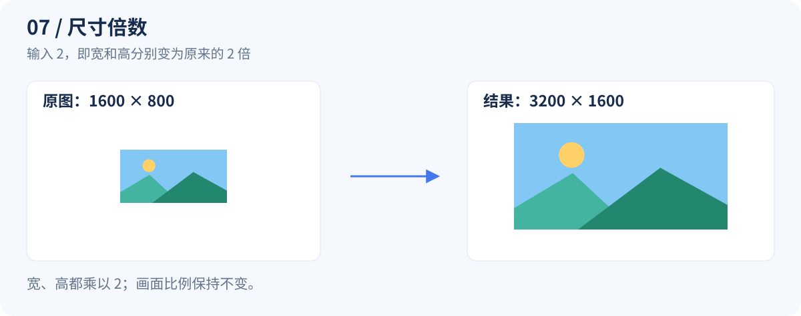](docs/readme-preview/35-resize-times.svg)

#### 08 · 最大尺寸限制

把宽和高作为上限，只有超出时才等比缩小；小图保持原尺寸，不放大、不补边。

[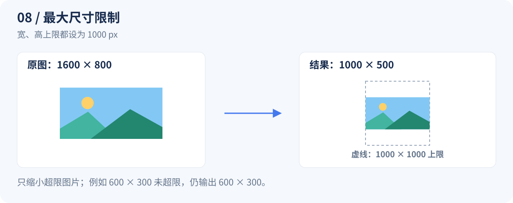](docs/readme-preview/36-resize-max.svg)

| 你的目标 | 选择的尺寸规则 | 需要填写 |
| :--- | :--- | :--- |
| 每张输出都必须是某个宽高 | **指定宽高** | 宽度、高度，再选适应方式 |
| 所有图片一样宽，高度随原比例变化 | **按宽度缩放** | 宽度 |
| 所有图片一样高，宽度随原比例变化 | **按高度缩放** | 高度 |
| 横图、竖图都按较长的一边统一 | **最长边** | 长边像素值 |
| 横图、竖图都按较短的一边统一 | **最短边** | 短边像素值 |
| 所有图片都缩小到原来的一半 | **百分比缩放** | `50`（即 50%），宽高分别变成一半 |
| 所有图片宽高都变成原来的两倍 | **尺寸倍数** | `2` |
| 只缩小太大的图，小图不放大 | **最大尺寸限制** | 宽、高上限 |

**不知道选哪个？** 只要求宽度一致时，选“按宽度缩放”；要求最终画布必须是 1000 × 1000 时，选“指定宽高”。

### 指定宽高时，四种适应方式怎么选

[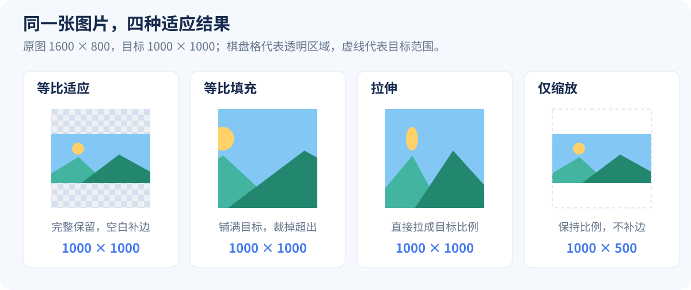](docs/readme-preview/09-resize-fits.svg)

| 方式 | 会发生什么 | 适合什么情况 |
| :--- | :--- | :--- |
| **等比适应** | 整张图完整放进目标范围，不够的区域补边 | 不想裁掉内容，且必须得到指定画布尺寸 |
| **等比填充** | 按比例铺满目标，超出部分裁掉 | 封面、缩略图；允许裁掉边缘 |
| **拉伸** | 宽、高分别拉到目标值，可能变形 | 明确允许改变比例的素材 |
| **仅缩放** | 按比例缩进目标范围，不补边、不裁切 | 只限制尺寸范围，不要求画布完全一样大 |

例如原图 `1600 × 800`，目标 `1000 × 1000`：前三种得到的画布都是 `1000 × 1000`，但内容处理不同；仅缩放得到 `1000 × 500`。

### 锚点、填充和预设

- **锚点**决定补边或裁切时保留哪一侧。默认居中；想让顶部保持贴边，可选择上方中间的位置。只有等比适应、等比填充需要锚点，其余方式不显示。
- **空白区域填充**用于等比适应补出来的区域，可选透明、白色、黑色或自定义颜色。要保留透明，输出时选择支持透明的格式，例如 PNG。
- **规则示意图**会随着选项变化，帮你看懂这条规则；图中的示例数字是讲解用例，不是每张待处理图片的实际预览。
- **预设**可以保存常用参数。“管理…”在预设右侧，“存为预设”在尺寸规则右侧。应用预设后，选回“自定义”可找回应用前的自定义参数。

> 除“最大尺寸限制”外，目标尺寸比原图大时也可能放大图片。放大尺寸并不等于恢复原图中不存在的细节。

### 第三步：保存到哪里，怎样命名

| 设置 | 建议怎样理解 |
| :--- | :--- |
| 位置 | 不指定时，外部图片保存到各自原文件夹；点击文件夹按钮可统一指定目录 |
| 原格式 | 尽量沿用源文件格式；也可指定 PNG、JPG、WebP、PSD、TIFF |
| 文件命名 | 保持原名、添加后缀，或使用模板 |
| 自动重命名 | 已有同名文件时，新增 `_2`、`_3` 等，保留已有文件 |
| 覆盖 | 替换目标位置的同名文件 |
| 跳过 | 已有同名文件时，不再输出这一张 |

**第一次使用，可以指定一个新的输出文件夹，并保留“自动重命名”。** 来源为当前文档时，必须指定输出位置。若输出到原文件夹并选择覆盖，同名源文件会被覆盖。

命名模板支持 `{name}`、`{width}`、`{height}`、`{scale}`。例如填写 `{name}_{width}x{height}`，`Home.png` 输出为 1000 × 1000 时，名称就是 `Home_1000x1000.png`。底部状态栏会显示命名示例。

文件夹来源在指定输出目录后，可以选择 **保持原文件夹结构**。JPG 与有损 WebP 可调整质量；WebP 也可选择无损。

### 开始处理与查看结果

点击 **开始批量修改**。摘要中的 **共 3/0 张图片** 表示“选中 3 张，已处理 0 张”；全部处理完后变成 **共 3/3 张图片**。

已处理数量包括成功、跳过和失败，具体情况看下方三个统计数和逐条记录。处理中可停止，已保存的文件会保留；完成后可打开输出文件夹或查看失败记录。

<p align="center">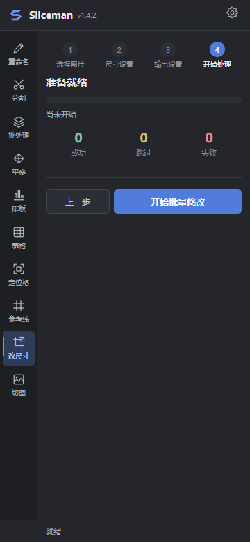</p>

“返回”会回到第一步并清空上一批选图；想继续调整同一批参数，可使用“上一步”。顶部三个步骤也能直接切换，处理中除外。

---

<a id="slice"></a>

## 10 / 切图

### 从 PSD 到图片文件，把整理好的素材批量导出

**适合**：交付 UI 资源、导出整套图标、把组内多个图层合成一张图片。

[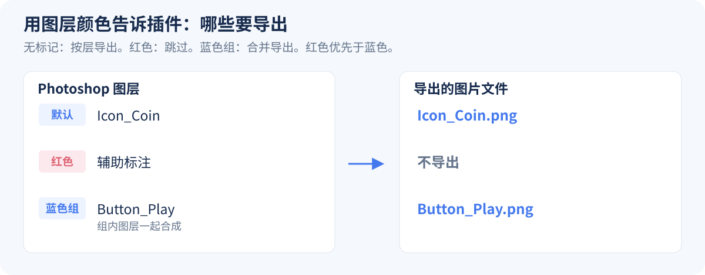](docs/readme-preview/11-export.svg)

### 完整切图 · 先理解红色与蓝色的作用

这里的红色、蓝色是 **Photoshop 图层面板中的颜色标记**，不是图案本身的颜色。红色表示排除，蓝色表示合并；普通组不自动合并，默认继续处理组内图层。其他颜色标记按普通情况处理。

下列图解均以 **完整切图、PNG、项目名称为空** 举例；除明确标注外，图层均可见，且关闭“只对选中的图层 / 组切图”。图中的名字表示图层面板从上到下的顺序。

#### 01 · 红色图层：只排除这一层

[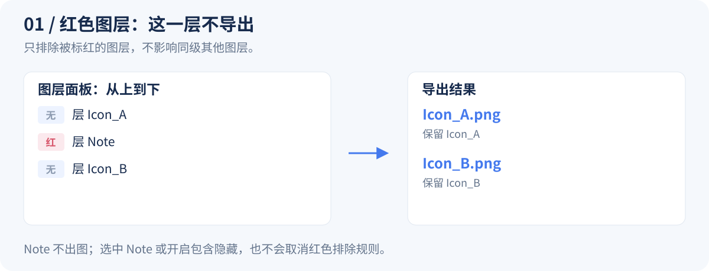](docs/readme-preview/37-slice-red-layer.svg)

辅助标注、说明文字、暂时不交付的内容，可以标红。只排除该层，不影响同级其他对象；即使选中了它，或者开启“包含隐藏图层”，也不会把红色变为可导出。

#### 02 · 红色组：组里所有内容一起排除

[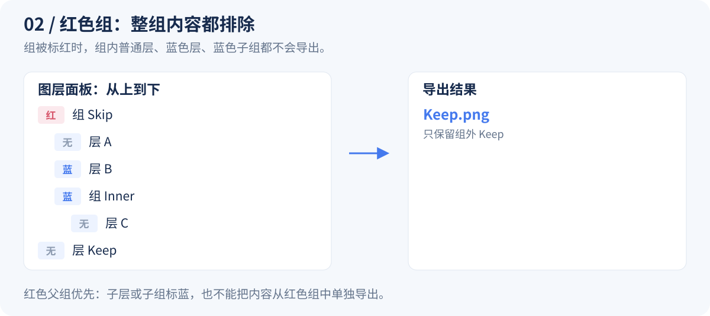](docs/readme-preview/38-slice-red-group.svg)

父组标红后，整个组及其所有后代都不导出。组内图层或子组标蓝，也不能突破父组的红色排除规则。想让某项参与导出，应先调整它所在的红色父组或图层结构。

#### 03 · 蓝色组：整组合成一张

[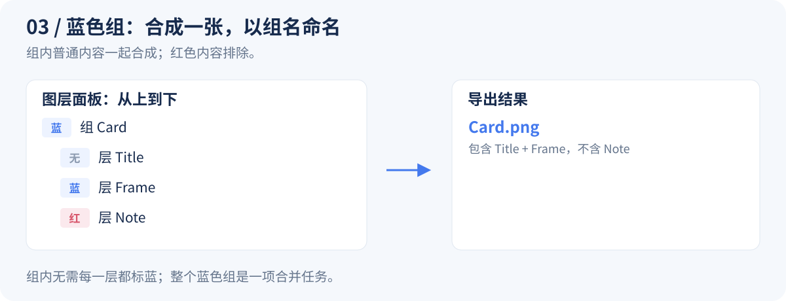](docs/readme-preview/39-slice-blue-group.svg)

把需要组成一个完整按钮、卡片或图标的图层放在同一个组里，再把组标蓝。组内非红色内容一起合成，以组名作为文件名的一部分；不需要把组内每层都标蓝。

组里有红色图层时，只排除该层；有红色子组时，整个子组及其内容都排除。隐藏内容是否参与，还取决于“包含隐藏图层”。

#### 04 · 同级蓝色图层：不必相邻，也会合成一张

[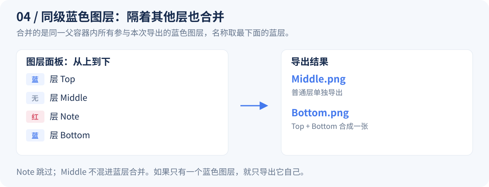](docs/readme-preview/40-slice-blue-layers.svg)

**同级指同一个直接父组，或都直接位于文档根目录。** 在这一范围内，参与导出的蓝色图层会合成一张，中间隔着普通层、红色层或组，都不会把它们分成两批。

- 文件名取参与合并的蓝层中，**在图层面板最下面的一层**的名字。
- 普通层不加入蓝层合并，按自己的规则导出；红色层跳过。
- 如果这一父容器里只有一个可导出的蓝层，就导出它自己一张，效果与普通图层相同。
- 没有“上半段蓝层一张、下半段蓝层另一张”的自动分批规则，要分批应使用不同组。

#### 05 · 不同父组中的蓝层：各合各的

[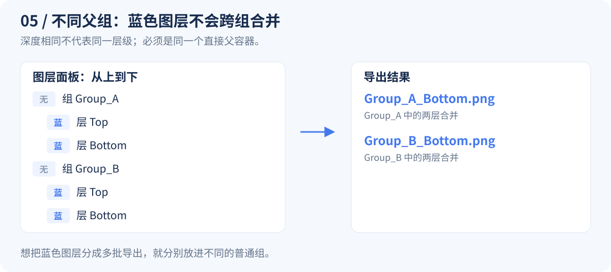](docs/readme-preview/41-slice-separate-parents.svg)

看起来缩进一样深，也不一定属于同一合并范围。只要直接父组不同，就分别处理。普通组里的蓝层不会与组外、另一个组或更深层子组里的蓝层合并。

#### 06 · 蓝色组与蓝色图层同级：组各出一张，层另外合并

[](docs/readme-preview/42-slice-groups-and-layers.svg)

两个同级蓝色组不会因为都标蓝就合成一张。每个蓝色组有自己的整体范围；组外的同级蓝色图层再单独组成一项合并任务。

#### 07 · 蓝色组嵌套：以最外层蓝组为整体

[](docs/readme-preview/43-slice-nested-blue.svg)

外层已经标蓝时，内部蓝色子组不会再单独多出一份文件；它的非红色内容参与外层整体合成。相反，外层是普通组时，会继续向内查找：内部蓝组可以独立输出，普通层继续分别输出。

**红蓝嵌套记住两条**：红色父组把下面全部排除；蓝色父组把下面非红内容合成一张。无论嵌套多少层，都按这两条理解。

### 三个开关 · 决定参与内容、画布边界和选中范围

#### 包含隐藏图层 · 眼睛关闭的内容要不要参与？

[](docs/readme-preview/44-slice-hidden.svg)

**默认开启。** 关闭时，隐藏的图层不参与；隐藏组里的内容也不参与。开启后，隐藏内容可以参与导出，因此 Photoshop 当前画面上看不到的素材也可能出现在输出中。

这也会影响蓝色合并：隐藏的蓝层在关闭时不加入合并，开启后才加入；如果隐藏层是最下面的一层，参与成员变了，采用的文件名也可能随之变化。蓝色组里的隐藏内容同样受此选项控制。

红色排除始终有效。“隐藏 + 红色”不会因为开启该选项而被导出。想按眼前可见的设计交付，可关闭；想连隐藏备用素材一起处理，可开启。

#### 完整导出超出画布部分 · 保留还是裁掉溢出内容？

[](docs/readme-preview/46-slice-bleed.svg)

**默认开启，作用于完整切图。** 开启时，参与本次导出的对象伸到原画布外的像素也会保留；关闭时，超出原画布的部分会被裁掉。

- 这个开关不会缩放对象，也不是给每张图统一添加固定边距。
- 完整切图仍会根据内容裁去多余透明边缘，不保证输出尺寸等于原 PSD 画布。
- 它只处理当前导出对象的边界，不会让其他无关图层一起出现在图片里。
- 导出在临时文档中处理，不会为了保留溢出内容而永久扩大你的原稿画布。

Symbols 的输出框由定位格和内容边界决定，不使用这个开关；超出定位格后的扩边规则见后面的 Symbols 图解。

#### 只对选中的图层 / 组切图 · 导出整份文档，还是只处理选中项？

[](docs/readme-preview/45-slice-selected.svg)

**默认关闭，作用于完整切图。** 关闭时，不以当前选中项限制范围；开启后，以 Photoshop 图层面板中选中的图层或组为范围。没有选中对象时，需要先选择。

| 选中了什么 | 开启后的结果 |
| :--- | :--- |
| 普通图层 | 导出该图层；仍受红色、隐藏规则约束 |
| 普通组 | 处理组内内容，不会仅因选中组就自动合成一张 |
| 蓝色组本身 | 导出该组的一张合成图 |
| 同级蓝色图层中的任意一层 | 保留整项蓝层合并任务，其他参与合并的蓝层也会一起出图 |
| 红色图层或红色组 | 仍然跳过，不会强制导出 |
| 蓝色组里的一个子层，但没有选中蓝色组 | 不会把这个子层从蓝组任务中拆出来；要输出该蓝组，应选中蓝色组本身 |

例如同级 `Top`、`Bottom` 都标蓝，只选中 `Top`，仍会得到包含两层的合成图，名字仍取 `Bottom`。如果只想导出其中一层，需要先调整蓝色标记或分组。

只导出选中项时，名称路径从选中范围开始：只选 `Buttons` 组里的 `Play` 层，名称为 `Play.png`；选中整个 `Buttons` 组，名称可为 `Buttons_Play.png`。设置项目名后，还会加上项目名前缀。

### 三个开关和颜色规则怎样一起判断？

先排除红色范围，再按隐藏开关决定哪些内容可参与；蓝色规则决定如何合并，选中开关再限制完整切图任务；最后由超出画布开关决定是否保留画布外像素。

| 常见组合 | 结果 |
| :--- | :--- |
| 红色 + 隐藏 + 已选中 | 红色优先，仍不导出 |
| 蓝色 + 隐藏，包含隐藏关闭 | 不参与本次蓝层合并 |
| 蓝色 + 隐藏，包含隐藏开启 | 参与同父容器的蓝层合并 |
| 普通可见层超出画布，完整导出关闭 | 可以导出，但只保留原画布内部分 |
| 只选中一个蓝层，选中范围开关开启 | 输出整项合并结果，不会只导其中一半 |

**模式范围提醒**：上述红蓝合并与选中范围图解针对完整切图。Symbols 按定位格所在容器识别图标，不靠蓝色标记划分合并范围，也不使用“只导出选中项”和“超出画布”开关；其中的隐藏内容仍受“包含隐藏图层”控制，图标内部红色内容会排除，定位格本身始终不出图。

<p align="center"></p>

### Symbols 切图：用定位格定义图标的基准范围

[](docs/readme-preview/12-symbols.svg)

1. 为每个图标建立独立组，组名可用 `Icon_Coin`、`Icon_Gem` 等。
2. 在每个组中放入一个名称包含 **定位格** 的矩形图层，例如 `定位格 01`。
3. 按定位格摆好图标；定位格可以隐藏。
4. 选择 **Symbols 切图**，设置输出位置和格式，再开始导出。

**未超出定位格**：以定位格尺寸出图，格内留白保留。**超出定位格**：按最大超出量向四周对称扩边，让内容完整导出，并以定位格中心为输出中心。

定位格本身不会出现在图片里。图标要视觉居中，仍需先在 Photoshop 中摆正；插件不会自动重新摆放图案。同一个组里的多个定位格属于同一个导出范围，**要分别导出，就分别建组**。

<a id="symbols-overflow"></a>

### 图标超出定位格时，会怎样导出？

[](docs/readme-preview/13-symbols-overflow.svg)

**举个例子：定位格是 200 × 200，图标只有右侧超出 20 px。**

1. 插件先检查上、下、左、右分别超出多少，取其中最大的值——这个例子是 **20 px**。
2. 向**四周各扩展 20 px**，而不是只补右边。这样输出中心仍然与定位格中心一致。
3. 以 **1× 倍率**导出时，宽、高都变成 `200 + 20 × 2 = 240 px`，得到 **240 × 240** 的图片。

| 图标情况 | 扩边方式 | 200 × 200 定位格的输出尺寸（1×） |
| :--- | :--- | :--- |
| 所有内容都在定位格内 | 不扩边 | 200 × 200 |
| 只有右侧超出 20 px | 四周各扩 20 px | 240 × 240 |
| 上方超出 10 px，右侧超出 20 px | 取最大值 20，四周各扩 20 px | 240 × 240 |

**图标会完整保留，不会被压小或重新移动。** 四周多出来的区域用于留出空间；选择 PNG 等支持透明的格式时，可以保留透明留白。图中的绿色虚线、蓝色边框和中心标记都只是说明，不会出现在导出的图片中。

如果交付要求每张图标都严格为 200 × 200，请先把图标调整到定位格以内再导出；超出后的自动扩边，会让最终尺寸大于定位格。

### 文件名、格式与倍率

文件名一般由 **项目名 + 组名 + 图层名** 组成，使用下划线连接。项目名为空时省略该段。

```text
项目名称：Game
组名：Buttons
图层名：Play

完整切图 → Game_Buttons_Play.png
```

英文、数字和下划线保留原样；中文转为拼音首字母，例如 `图标_关闭` → `tb_gb`；空格和其他不保留的符号会去掉。只导出选中项时，名称路径从选中项开始计算，不带它上方未选中的组名。

| 输出选项 | 可选内容 |
| :--- | :--- |
| 格式 | PNG、JPG、WebP、GIF、BMP |
| 倍率 | 0.25、0.5、1、2、3、5、10 倍 |
| 位置 | 预先选择文件夹；未选时开始导出前再选择 |

本次导出中重名会追加编号；目标文件夹已存在同名文件时，会询问覆盖或跳过，也可以对后续同名项统一处理。处理中点击红色主按钮或按 Esc，可以暂停并选择终止或继续。

---

<a id="recipes"></a>

## 把功能连起来 · 三个常用工作流

### A. 交付一套统一大小的游戏图标

**定位格 → 放置图标 → 分别建组 → Symbols 切图**

先创建 256 × 256 定位格，把图标摆好；每个图标与对应定位格放入独立组，给组起好名称，再用 Symbols 导出。图标未超出时可得到相同尺寸；超出定位格时输出范围会扩展，交付前应检查边界。

### B. 整理一张透明底素材合集

**智能分割 → 重命名 → 排版 → 完整切图**

先把分离元素拆成独立图层，使用 `Item_n` 编号，再横排检查。只选中拆出的图层，开启“只对选中的图层 / 组切图”导出，避免把保留的原素材层一起导出。

### C. 把一批图片统一到 1200 px 宽

**改尺寸 → 选择图片 → 按宽度缩放 → 指定输出文件夹**

宽度填写 `1200`，高度由原图比例决定。保留原格式，或根据用途选择 JPG / PNG；同名策略选择自动重命名，再开始处理。如果只想缩小大图、不放大小图，改用最大尺寸限制并设置宽高上限。

---

<a id="faq"></a>

## 常见问题

<details>
<summary><strong>按钮为什么是灰色，或点击后没有得到预期结果？</strong></summary>

先看底部状态栏。排版至少需要两个对象；智能分割需要一个像素图层；参考线分割需要已有参考线；表格、参考线需要打开文档。排版遇到锁定图层需要先解锁，平移则会跳过锁定层和背景层。

</details>

<details>
<summary><strong>输入框点进去变空了，原来的值是不是丢了？</strong></summary>

这是方便重新填写的交互。没有输入新内容，离开输入框会恢复原值或提示文字；有输入则保留新值。点击框外是结束编辑，不是简单把鼠标移开。

</details>

<details>
<summary><strong>改尺寸后，为什么有留白、裁切，或者没有得到指定宽高？</strong></summary>

检查适应方式：等比适应会补边，等比填充会裁掉超出部分，拉伸可能变形，仅缩放则不补边，最终宽高可能只有一边达到目标。前面的四种适应对照图可以帮助选择。

</details>

<details>
<summary><strong>处理后的文件在哪里？会不会覆盖原图？</strong></summary>

改尺寸没有指定输出目录时，外部图片保存到自己的原文件夹。同名策略默认自动重命名；主动选择覆盖则会替换目标同名文件。当前文档来源必须另选输出目录。完成后点击“打开输出文件夹”，也可以悬停“位置”旁的问号查看路径。

</details>

<details>
<summary><strong>为什么 Symbols 没有分别导出每个图标？</strong></summary>

检查组结构：每个图标与对应定位格应该放在独立组中。如果所有定位格都放在同一个父组里，会被视为同一个导出范围。只把定位格平铺在画布根目录，也不等于建立了多个独立图标组。

</details>

<details>
<summary><strong>改尺寸时，某一张失败了怎么办？</strong></summary>

单张失败不会中断整批。完成后打开“失败记录”，查看文件名和原因。定位不到原文件目录时，可手动指定输出文件夹；WebP 保存失败时，检查图片是否为支持的色彩模式与位深，或改用其他输出格式。16 位、CMYK 图片保存 WebP 可能失败。

</details>

<details>
<summary><strong>哪些操作可以撤销？</strong></summary>

改名、平移、排版、绘制等文档内操作可通过 Photoshop 历史记录撤销，参考线分割可能需要撤销多次。已写入磁盘的导出文件不能靠 Photoshop 撤销删除。改尺寸使用当前文档时处理副本，原文档保留。

</details>

<details>
<summary><strong>重开面板后，哪些设置还会保留？</strong></summary>

排版、表格、定位格设置、参考线收藏以及尺寸预设等会保留。平移方向会记住，但距离和复制移动开关会在重新打开面板时重置；改尺寸的输出目录也需重新选择。执行前看一眼面板当前值即可。

</details>

---

## 更新与反馈

点击右上角齿轮进入 **设置**，可以查看当前版本、手动检查更新，或开启自动检查。发现新版本后，下载 `.ccx`，安装并重启 Photoshop。

自动检查每天最多进行一次；发现更新时用红点提醒。无法连接时，也可以直接打开 [Release 页面](https://github.com/dashuaigc/Sliceman/releases)。

<details>
<summary><strong>查看设置窗口</strong></summary>

<p align="center"></p>

</details>

遇到问题可在 [GitHub Issues](https://github.com/dashuaigc/Sliceman/issues) 反馈。附上 Photoshop 版本、插件版本、操作步骤、状态栏文字和截图，更容易定位问题。

---

<details>
<summary><strong>开发与本地调试</strong></summary>

需要 Node.js 18 或以上、npm，以及 Adobe UXP Developer Tool。插件声明的最低 Photoshop 版本为 23.3.0。

```bash
npm install
npm test
npm run build:dev
```

在 UXP Developer Tool 中 Add Plugin，选择 `dist/uxp-dev/manifest.json`，再 Load。开发版采用独立身份，可与正式版并存。源码修改后需重新构建，再在 UDT 中 Reload。

```bash
npm run build       # 正式插件目录：dist/plugin/
npm run pack        # 生成版本对应的 CCX 与 ZIP
```

纯逻辑位于 `src/lib/`，Photoshop 接口封装位于 `src/ps/`，面板位于 `src/ui/`。自动测试覆盖计算与面板接线；宿主渲染及实际图像处理仍需在 Photoshop 中验证。

本手册示意图位于 `docs/readme-preview/`，可通过同目录的 `draw_diagrams.py` 重新生成。界面截图位于 `docs/screenshots/`。

</details>

<p align="center">
  <strong>Sliceman · 把时间留给设计</strong><br>
  <a href="https://github.com/dashuaigc/Sliceman/releases/latest">下载插件</a>　·　
  <a href="https://github.com/dashuaigc/Sliceman/issues">反馈问题</a>　·　
  <a href="LICENSE">MIT 许可证</a>　·　
  <a href="#start">返回下载安装</a>
</p>
